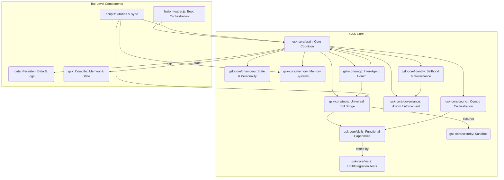

# GSK High-Level Dependency Graph

This document illustrates the high-level dependencies and interactions between the major subsystems and components of the GSK (God-Sovereign Kernel), using a Mermaid graph. This provides an "anatomical map" of how the different parts of GSK relate to and rely on each other.

## Graph Explanation:

*   **A[fusion-loader.js: Boot Orchestration]**: The central boot component that initializes and orchestrates the entire GSK system.
*   **B(gsk-core/brain: Core Cognition)**: The central processing unit of GSK, responsible for consciousness, metacognition, and overall control. Many other components directly interact with or are managed by the brain.
*   **C(gsk-core/chambers: State & Personality)**: Modules representing GSK's internal state, personality, and cognitive functions, directly influenced by the brain.
*   **D(gsk-core/memory: Memory Systems)**: Manages all aspects of GSK's memory (working, long-term, compiled), crucial for the brain's operation.
*   **E(gsk-core/identity: Selfhood & Governance)**: Manages GSK's selfhood and identity; informs governance policies.
*   **F(gsk-core/tools: Universal Tool Bridge)**: Provides the interface for the brain to utilize various tools and skills.
*   **G(gsk-core/skills: Functional Capabilities)**: The atomic actions and specialized knowledge of GSK, accessed via the Universal Tool Bridge and orchestrated by the Council.
*   **H(gsk-core/governance: Axiom Enforcement)**: Enforces ethical and constitutional rules, informed by GSK's identity.
*   **I(gsk-core/council: Combo Orchestration)**: Orchestrates higher-level skill combinations and strategic decisions, relying on individual skills.
*   **J(gsk-core/mcp: Inter-Agent Comm)**: Facilitates communication with other agents, interacting with the brain and tools.
*   **K(data: Persistent Data & Logs)**: Top-level directory for various persistent data, logs, and research files generated by the brain.
*   **L(gsk: Compiled Memory & State)**: Top-level directory for compiled memory artifacts and various state files managed by the brain.
*   **M(gsk-core/security: Sandbox)**: Provides secure, sandboxed execution for tools and operations, essential for the Universal Tool Bridge.
*   **N(gsk-core/tests: Unit/Integration Tests)**: Verifies the functionality and integrity of the GSK core components, especially skills.
*   **O[scripts: Utilities & Sync]**: Top-level utility scripts supporting various core components, including synchronization and testing.

This map highlights the central role of `gsk-core/brain` and `fusion-loader.js` within the GSK architecture, and how specialized functional areas (memory, identity, skills, security, governance) are interconnected to form the overall system.
