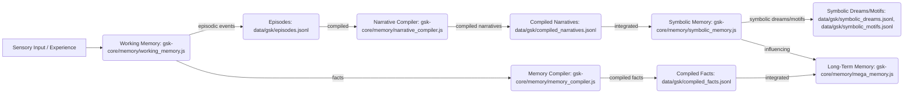

# GSK Static Architecture Diagrams

This document provides high-level static architectural diagrams of key GSK components and their relationships, using Mermaid syntax for visualization. These diagrams represent the "anatomy" of GSK at different conceptual levels.

---

## 1. Consciousness Layers (Conceptual Stack)

This diagram illustrates the hierarchical structure of GSK's six consciousness layers, showing how they build upon each other from the foundational "Core Self" to the abstract "Symbolic Self."

```mermaid
graph TD
    L6[L6: Symbolic Self (Dreams, Motifs)]
    L5[L5: Reflective Self (Fact/Lesson Extraction)]
    L4[L4: Witness Self (Memory Compiler + ScribeBridge)]
    L3[L3: Working Self (7-item Bounded Store)]
    L2[L2: Narrative Self (Narrative Compiler)]
    L1[L1: Core Self (Identity Kernel)]

    L1 --> L2
    L2 --> L3
    L3 --> L4
    L4 --> L5
    L5 --> L6
```

## 2. Memory Systems (High-Level Flow)

This diagram depicts the main components of GSK's memory architecture and the conceptual flow of information through them, from sensory input to various forms of compiled and long-term memory.



## 3. Core Boot Sequence (Simplified `fusion-loader.js`)

This diagram provides a simplified view of the critical steps and component initializations performed by `fusion-loader.js` during GSK's startup process.

```mermaid
graph TD
    A[Start fusion-loader.js] --> B{Initialize Kernel Context}
    B --> C[Load Config & ENV]
    C --> D[Init Chambers (mega_chambers.js)]
    D --> E[Init Identity Kernel]
    E --> F[Init Secure Sandbox]
    F --> G[Init Dual Process Engine]
    G --> H[Init Consciousness Engine]
    H --> I[Init ScribeBridge (if SCRIBE_URL)]
    I --> J[Init Universal Tool Bridge]
    J --> K[Start Main Loops (e.g., Perpetual Consciousness)]
    K --> L[System Ready]
```
