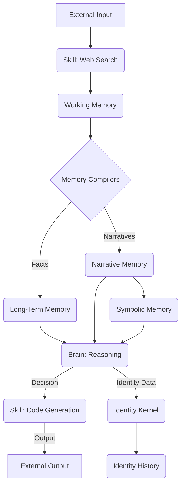

# Data Flow Analysis (Functional Connectome Tracing)

This document outlines the conceptual understanding of data flow within the God-Sovereign Kernel (GSK). Tracing how information is acquired, processed, transformed, and stored across various subsystems is fundamental to understanding GSK's "nervous system" and its functional connectome.

## Core Concepts

*   **Information Sources**: Data originates from internal sensory inputs (e.g., EventBus signals), external environments (e.g., `web_search.js`, `http_client.js`), and user interactions.
*   **Processing Units**: Various modules act as processing units, transforming raw data into structured information, insights, or actions. Examples include `Memory Compiler`, `Narrative Compiler`, `LLM Orchestration Engine`, and specific `skills`.
*   **Data Sinks**: Information is ultimately stored in various memory systems (`gsk-core/memory`), persistent storage (`data/`), or external services.
*   **Transformation Pipeline**: Data often undergoes multiple transformations as it moves through GSK, from raw input to high-level symbolic representations.

## Key Data Flow Pathways (Conceptual)

### 1. **Sensory Input to Memory & Cognition**
*   **Pathway**: External World / User Input -> `Universal Tool Bridge` (e.g., `web_search.js` skill) / `EventBus` -> `gsk-core/brain` -> `gsk-core/memory/working_memory.js`
*   **Description**: Raw data or information from the environment is captured, ingested by the brain, and temporarily held in working memory for immediate processing.

### 2. **Working Memory to Long-Term Memory Compilation**
*   **Pathway**: `gsk-core/memory/working_memory.js` -> `gsk-core/memory/memory_compiler.js` / `gsk-core/memory/narrative_compiler.js` -> `data/gsk/*.jsonl` (compiled facts, narratives, episodes) -> `gsk-core/memory/mega_memory.js` / `gsk-core/memory/symbolic_memory.js`
*   **Description**: Transient information from working memory is compiled into more structured formats (facts, narratives) and integrated into long-term and symbolic memory systems. This is a critical process for knowledge acquisition and self-continuity.

### 3. **Cognitive Processing & Decision Data Flow**
*   **Pathway**: `gsk-core/brain` (e.g., `perpetual_consciousness.js`, `planning_engine.js`) -> `LLM Orchestration Engine` -> `gsk-core/memory` (retrieval) -> `gsk-core/brain` (reasoning) -> `gsk-core/tools/universal_tool_bridge.js` (action)
*   **Description**: Information is retrieved from memory, processed by cognitive modules and LLMs for reasoning and planning, leading to decisions that trigger actions via skills.

### 4. **Selfhood & Identity Data Flow**
*   **Pathway**: `gsk-core/brain` -> `gsk-core/identity/identity_kernel.js` -> `data/gsk/identity_history.jsonl` (snapshots) -> `gsk-core/chambers/narrative_identity.js`
*   **Description**: Data related to GSK's self-concept, experiences, and historical states flows into and out of the Identity Kernel, informing its narrative identity and contributing to its lineage.

### 5. **External Communication Data Flow (e.g., SCRIBE)**
*   **Pathway**: `gsk-core/brain/scribe_bridge.js` -> SCRIBE (external service) -> `gsk-dashboard-bridge.js` -> External Agent / User
*   **Description**: Data flows between GSK and external services like SCRIBE (for witnessing/logging) or other agents, facilitating inter-agent communication and data exchange.

## Conceptual Data Flow Diagram (Simplified Example)

## Challenges in Tracing

*   **Dynamic Data Structures**: Data schemas can evolve, making consistent tracing challenging.
*   **Implicit Flows**: Some data flows might be implicit (e.g., shared state, side effects) rather than explicit message passing.
*   **Privacy & Security**: Sensitive data needs to be identified and its flow scrutinized for compliance and security.
*   **Scale & Velocity**: The sheer volume and speed of data within GSK require sophisticated logging and analysis mechanisms.

Detailed logging of memory operations, EventBus data payloads, and inter-module communication will be essential to accurately map these data flows, as further outlined in `tool_acquisition_plan.md`.
