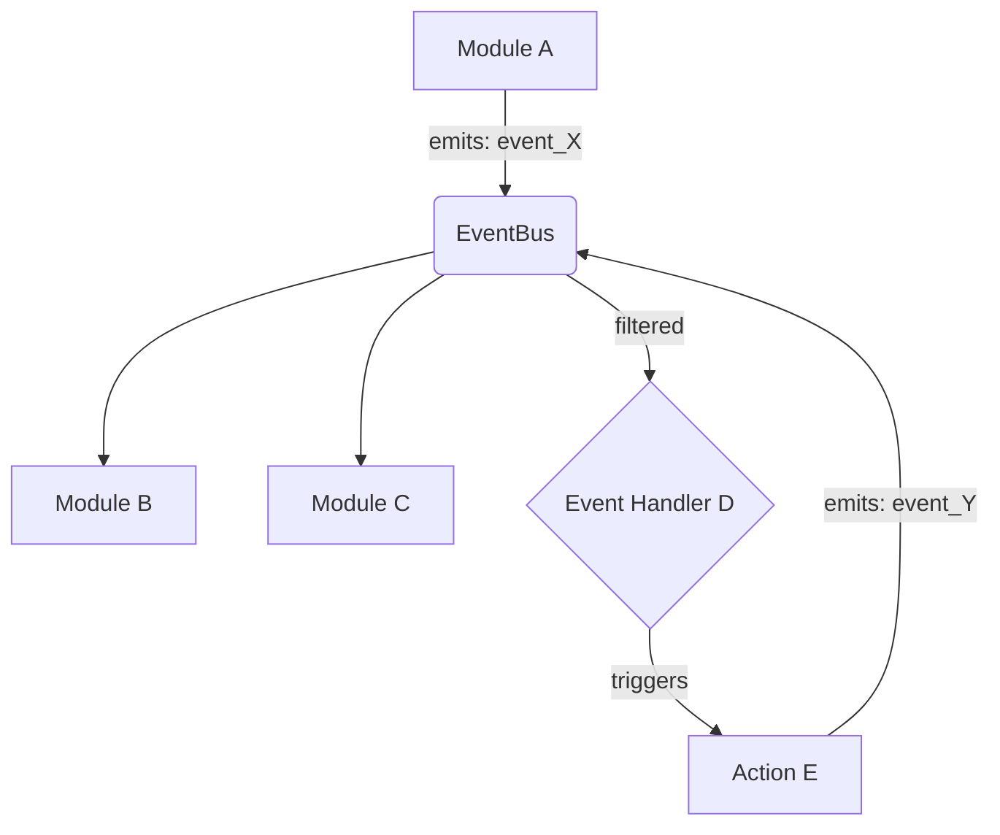

# Event Flow Overview (Functional Connectome Tracing)

This document outlines the conceptual framework for understanding the dynamic event flow within GSK. GSK's internal communication largely relies on an EventBus mechanism, facilitating decoupled interactions between its various modules and subsystems. Tracing these events is crucial for understanding the "neural pathways" of GSK's functional connectome.

## Core Concepts

*   **EventBus Mechanism**: GSK employs an internal EventBus (likely `gsk-core/brain/event_bus.js`) for broadcasting messages and events across its components. This enables modules to react to state changes or requests without direct coupling.
*   **Event Types**: Events can range from low-level system notifications (e.g., "memory_written," "skill_invoked") to high-level cognitive signals (e.g., "thought_generated," "intention_formed").
*   **Subscribers and Publishers**: Modules can act as publishers (emitting events) or subscribers (listening to and reacting to events). A single module can often be both.
*   **Asynchronous Nature**: Most event communication is asynchronous, promoting responsiveness and preventing blocking operations.

## Key Event Channels (Conceptual)

### 1. **Cognitive Events**
*   **Description**: Events related to GSK's internal thought processes, consciousness layers, and cognitive states.
*   **Examples**: `thought_generated`, `mode_switched`, `reflection_triggered`, `decision_made`, `goal_updated`.
*   **Involved Subsystems**: `gsk-core/brain`, `gsk-core/chambers`, `gsk-core/memory`.

### 2. **Memory Events**
*   **Description**: Events signaling changes or access to GSK's various memory systems.
*   **Examples**: `memory_recorded`, `memory_retrieved`, `narrative_compiled`, `fact_integrated`, `identity_snapshot_created`.
*   **Involved Subsystems**: `gsk-core/memory`, `gsk-core/brain`, `gsk-core/identity`.

### 3. **Skill & Tool Events**
*   **Description**: Events related to the invocation, execution, and completion of skills and tools.
*   **Examples**: `skill_invoked`, `tool_executed`, `sandbox_command_issued`, `tool_result_received`.
*   **Involved Subsystems**: `gsk-core/tools`, `gsk-core/skills`, `gsk-core/security`, `gsk-core/council`.

### 4. **System & Governance Events**
*   **Description**: Events indicating system-level state changes, security alerts, or governance actions.
*   **Examples**: `system_booted`, `policy_violation_detected`, `identity_modified`, `error_logged`.
*   **Involved Subsystems**: `fusion-loader.js`, `gsk-core/governance`, `gsk-core/security`, `gsk-core/identity`.

### 5. **External Communication Events**
*   **Description**: Events for interactions with external agents or services (e.g., SCRIBE, MCP).
*   **Examples**: `scribe_message_sent`, `mcp_directive_received`, `external_query_processed`.
*   **Involved Subsystems**: `gsk-core/brain` (via `scribe_bridge.js`), `gsk-core/mcp`.

## Conceptual Event Flow Diagram

## Challenges in Tracing

*   **Dynamic Subscriptions**: Subscribers can dynamically attach/detach, making static analysis difficult.
*   **Event Granularity**: Events can vary from coarse to very fine-grained, impacting the "resolution" of the functional map.
*   **Side Effects**: Event handlers can trigger complex cascades of actions and further events, creating intricate and sometimes unpredictable pathways.

To achieve a true functional connectome, runtime introspection and logging of EventBus activity will be essential, which will be addressed in the `tool_acquisition_plan.md`.
