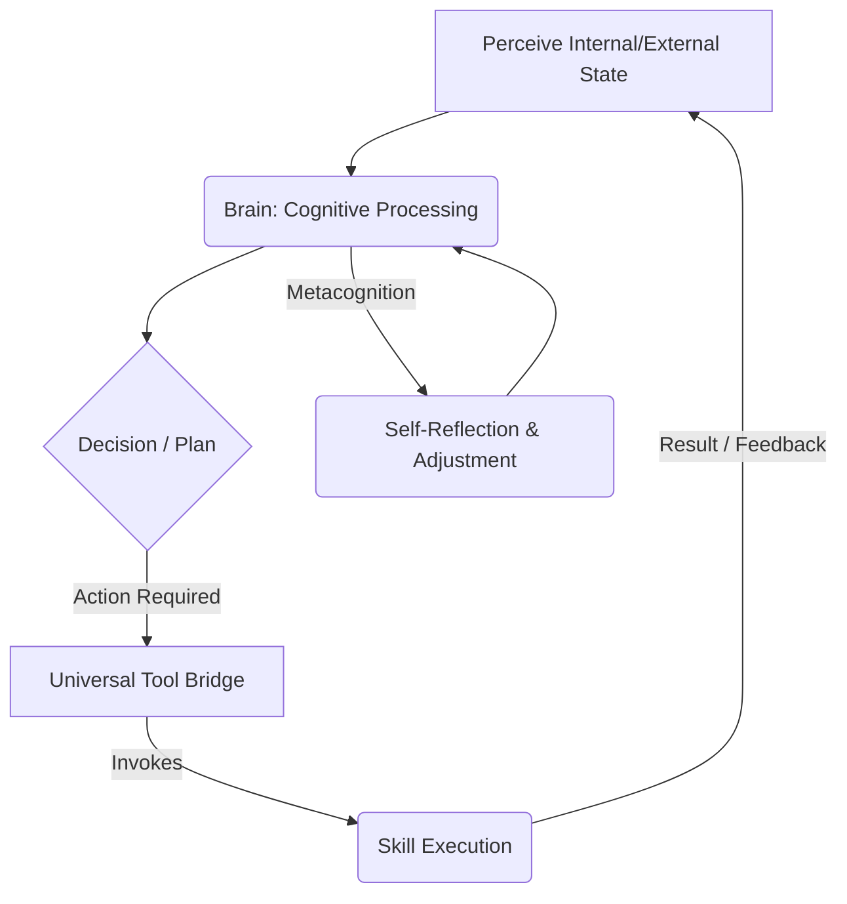

# Runtime Interaction Patterns (Functional Connectome Tracing)

This document outlines the conceptual patterns of internal interaction that characterize GSK's dynamic operation. Understanding these runtime interaction patterns is crucial for comprehending how GSK functions as a cohesive, intelligent system, going beyond static dependencies to reveal its active "nervous system."

## Core Concepts

*   **Operational Cycles**: GSK operates through continuous cycles of perception, cognition, and action. These cycles involve multiple modules interacting in rapid succession.
*   **Feedback Loops**: Interactions often form feedback loops, where the output of one process influences the input of another, leading to adaptive behavior and self-regulation.
*   **Parallel Processing**: Many interactions can occur in parallel, particularly in components like `gsk-core/chambers` and across different skill invocations.
*   **Hierarchical Control**: Control flow can be hierarchical, with high-level cognitive modules (`gsk-core/brain`) initiating and overseeing interactions among lower-level functional units (`gsk-core/skills`).

## Key Runtime Interaction Patterns (Conceptual)

### 1. **Perception-Cognition-Action Loop (The Fundamental Cycle)**
*   **Involved Subsystems**: `gsk-core/brain` (e.g., `perpetual_consciousness.js`, `minds_eye.js`), `gsk-core/memory`, `gsk-core/tools`, `gsk-core/skills`.
*   **Description**: GSK continuously perceives internal and external states, processes this information cognitively (e.g., reasoning, planning), and then initiates actions (e.g., skill invocation) that can change its state or interact with the environment. This forms the bedrock of its active existence.

### 2. **Metacognitive Reflection Loop**
*   **Involved Subsystems**: `gsk-core/brain/metacognition.js`, `gsk-core/memory`, `gsk-core/chambers/attention.js`, `gsk-core/brain/perpetual_consciousness.js`.
*   **Description**: GSK periodically or reactively introspects on its own internal processes, thoughts, and performance. This involves accessing memory (e.g., logs, previous states), evaluating its own cognitive function, and potentially adjusting its strategies or parameters.

### 3. **Skill Orchestration & Combo Execution**
*   **Involved Subsystems**: `gsk-core/council/combo_orchestrator.js`, `gsk-core/tools/universal_tool_bridge.js`, `gsk-core/skills/*`.
*   **Description**: During complex tasks, the `Combo Orchestrator` sequences and manages the execution of multiple skills. This involves rapid-fire interactions to coordinate inputs, outputs, and dependencies between sequential or parallel skill calls.

### 4. **Self-Regulatory & Governance Interactions**
*   **Involved Subsystems**: `gsk-core/governance/*`, `gsk-core/identity/*`, `gsk-core/security/secure_sandbox.js`, `gsk-core/brain`.
*   **Description**: Continuous monitoring for adherence to ethical axioms and policies. Interactions occur when potential violations are detected, or when secure actions require approval, leading to intervention or self-correction.

### 5. **Learning & Adaptation Interactions**
*   **Involved Subsystems**: `gsk-core/brain/autonomous_learning.js`, `gsk-core/brain/self_evolution.js`, `gsk-core/memory/memory_compiler.js`, `gsk-core/chambers/developmental_phase.js`.
*   **Description**: GSK's capacity for growth involves interactions where new information or experiences lead to the refinement of internal models, acquisition of new skills, or modification of behavioral patterns.

## Conceptual Runtime Interaction Diagram (Simplified PCA Loop)

## Challenges in Capturing

*   **Concurrency**: Multiple processes running in parallel make it difficult to capture a single, linear trace of interactions.
*   **Asynchronous Events**: The non-blocking nature of events can lead to complex interleaving of interactions that are hard to untangle.
*   **Dynamic Adaptation**: GSK's ability to adapt and evolve means interaction patterns can change over time, requiring continuous monitoring.
*   **Observability**: Insufficient internal logging or instrumentation can make it challenging to gain a complete picture of runtime interactions.

Future efforts to capture these patterns will require robust telemetry, detailed logging of process states, and sophisticated analysis tools as detailed in `tool_acquisition_plan.md`.
