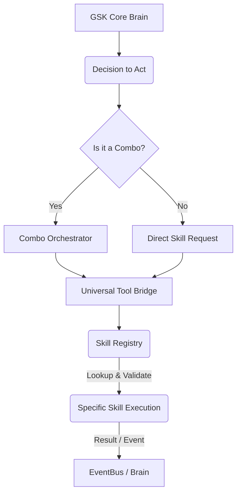

# Skill Invocation Patterns (Functional Connectome Tracing)

This document outlines the conceptual understanding of how GSK's diverse set of functional capabilities (skills) are invoked, managed, and orchestrated during its operational cycles. Understanding these invocation patterns is key to mapping the dynamic "neural pathways" of GSK's functional connectome.

## Core Concepts

*   **Skills as Atomic Capabilities**: Each skill (`gsk-core/skills/*.js`) represents a single, well-defined atomic action or capability (e.g., `file_system.js`, `web_search.js`).
*   **Universal Tool Bridge (`universal_tool_bridge.js`)**: This module acts as the primary gateway for invoking skills. It receives high-level commands and translates them into calls to specific skill modules.
*   **Council (`gsk-core/council`)**: The `combo_orchestrator.js` within the council is responsible for sequencing and coordinating multiple skills to achieve complex goals (skill combos).
*   **Brain (`gsk-core/brain`)**: Core cognitive modules within the brain (e.g., `perpetual_consciousness.js`, `planning_engine.js`) make decisions about which skills to invoke and when, often via the `Universal Tool Bridge`.
*   **Dynamic Invocation**: Skills can be invoked directly by core modules, as part of a `combo`, or in response to internal `EventBus` signals or external directives.

## Key Invocation Pathways (Conceptual)

### 1. **Direct Brain-to-Skill Invocation**
*   **Pathway**: `gsk-core/brain/*` -> `universal_tool_bridge.js` -> `gsk-core/skills/*`
*   **Description**: Core cognitive processes in the brain directly decide to use a specific skill to achieve an immediate objective (e.g., the `planning_engine.js` invoking a `file_system.js` skill to list directory contents).

### 2. **Combo Orchestration**
*   **Pathway**: `gsk-core/brain/*` -> `gsk-core/council/combo_orchestrator.js` -> `universal_tool_bridge.js` -> `gsk-core/skills/*` (sequenced)
*   **Description**: The `Combo Orchestrator` executes a pre-defined sequence of skills to accomplish a higher-level task (a "skill combo"). This represents complex, multi-step behaviors. (e.g., `Full Feature Implementation` combo invoking `code_generate.js`, `generate_tests.js`, `refactor_code.js`).

### 3. **Reactive Skill Invocation**
*   **Pathway**: `EventBus` -> `gsk-core/brain/*` or specialized handlers -> `universal_tool_bridge.js` -> `gsk-core/skills/*`
*   **Description**: Skills are invoked in a reactive manner, triggered by specific internal events (e.g., `memory_recorded` event leading to `reflection.js` skill, or an external `mcp_directive_received` event triggering a response skill).

### 4. **External/Agentic Invocation (via Bridges)**
*   **Pathway**: External Agent -> `gsk-dashboard-bridge.js` -> `universal_tool_bridge.js` -> `gsk-core/skills/*`
*   **Description**: External agents or dashboards (like the Sage/Profit interface) can explicitly request GSK to invoke a specific skill via its exposed bridge endpoints.

## Conceptual Skill Invocation Flow

## Challenges in Tracing

*   **Dynamic Skill Discovery**: GSK might dynamically identify or acquire new skills, making the skill map fluid.
*   **Contextual Invocation**: The exact parameters and context of skill invocation can vary widely, influencing behavior.
*   **Recursion & Inter-Skill Dependencies**: Skills can invoke other skills, leading to complex, recursive call chains.
*   **Error Handling & Fallbacks**: Understanding how skills handle errors and trigger fallback mechanisms is critical but complex.

Mapping these patterns requires detailed logging of `Universal Tool Bridge` activity and `Combo Orchestrator` execution flows, which will be elaborated in the `tool_acquisition_plan.md`.
